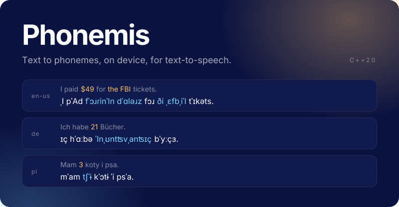

<p align="center">
  <a href="LICENSE"></a>
  <a href="https://discord.swmansion.com"></a>
</p>

Phonemis turns text into IPA phonemes. It's the grapheme-to-phoneme (G2P) front end of a text-to-speech (TTS) model:
it reads numbers, dates, money, and abbreviations aloud, picks each word's pronunciation from a lexicon or a small
neural model, and returns the phonemes the TTS model speaks.

* **Ten language variants:** English (US and UK), German, French, Spanish, Italian, Polish, Portuguese, Hindi, and
  Mandarin Chinese.
* **Runs on device:** a C++20 static library with no runtime dependencies, for desktop, Android, and iOS.
* **Word positions:** `phonemize_words` maps each input word to its phonemes, so you can highlight words as they're
  spoken.

## Quick start

Clone with the [Verbalis](https://github.com/software-mansion-labs/Verbalis) submodule, which reads text aloud
before phonemization, then build and run the tests:

```bash
git clone --recursive https://github.com/software-mansion-labs/Phonemis.git
cd Phonemis
cmake -S . -B build -DBUILD_TESTS=ON -DBUILD_RUNNER=ON
cmake --build build -j
./build/phonemis_test
```

To phonemize a sentence from the command line, run `phonemis_runner`:

```bash
./build/phonemis_runner --lang en-us \
    --lexicon data/en-us/lexicon_full.json \
    --model data/en-us/phonemizer_en_us.bin \
    --tagger data/en-us/tagger.json \
    "I paid \$49 for the FBI tickets."
```

```text
Preprocessed: I paid forty-nine dollars for the FBI tickets.
Output: ˌI pˈAd fˈɔɹɾinˈIn dˈɑləɹz fɔɹ ði ˌɛfbˌiˈI tˈɪkəts.
```

`--no <step>` turns off a preprocessing step: `normalize`, `trim`, `terms`, `numbers`, or `symbols`.

## Languages

Each language reads its files from `data/<code>/`. You pass their paths in `Config`:

| Code | Language | Lexicon (`lexicon_filepath`) | Neural model (`nn_model_filepath`) | `tagger` |
|---|---|---|---|---|
| `en-us` | English (US) | `lexicon_full.json`, `lexicon_small.json` | `phonemizer_en_us.bin` | `tagger.json` |
| `en-gb` | English (UK) | `lexicon_full.json`, `lexicon_small.json` | `phonemizer_en_gb.bin` | `tagger.json` |
| `de` | German | | `phonemizer_de.bin` | |
| `fr` | French | | `phonemizer_fr.bin` | |
| `es` | Spanish | | `phonemizer_es.bin` | |
| `it` | Italian | | `phonemizer_it.bin` | |
| `pl` | Polish | | `phonemizer_pl.bin` | |
| `pt` | Portuguese | | `phonemizer_pt.bin` | |
| `hi` | Hindi | | `phonemizer_hi.bin` | |
| `zh` | Mandarin Chinese | `lexicon.json` | | `segmenter.json` |

For English, the tagger picks the pronunciation that depends on the part of speech (*read*, *used to*). It's derived
from a corpus licensed for non-commercial use only, so leave it out in commercial products; see
[Third-party notices](#license). For Mandarin Chinese, the `tagger` field takes the word segmenter instead.

## Usage

Link the `phonemis` CMake target, then create a `Pipeline` for a language:

```cpp
#include <phonemis/base/pipeline.h>
#include <phonemis/utils/conversions.h>
#include <iostream>

int main() {
  using namespace phonemis;

  Pipeline pipeline(Config{
      .lang = "en-us",
      .tagger = tagger::Config{.data_filepath = "data/en-us/tagger.json"},
      .phonemizer = phonemizer::Config{
          .lang = "en-us",
          .lexicon_filepath = "data/en-us/lexicon_full.json",
          .nn_model_filepath = "data/en-us/phonemizer_en_us.bin",
      },
  });

  std::u32string phonemes = pipeline("I read it on 3 May.");
  std::cout << utils::conversions::u32_to_utf8(phonemes) << "\n";  // ˌI ɹˈid ɪt ˌɔn ðə θˈɜɹd ʌv mˈA.
}
```

A pipeline takes UTF-8 (`std::string_view`) or UTF-32 (`std::u32string_view`) text, and returns phonemes as
`std::u32string`. Its stages, `preprocess()`, `process()`, and `postprocess()`, are public too.

### Word positions

`phonemize_words` returns the phonemes together with the position of each input word in them. Offsets and lengths
count UTF-32 code points:

```cpp
std::u32string text = U"He's 25 years old.";
PhonemizedText result = pipeline.phonemize_words(text);

for (const PhonemizedWord& word : result.words) {
  auto written = text.substr(word.offset, word.length);
  auto spoken = result.phonemes.substr(word.phoneme_offset, word.phoneme_length);
  // He's → hˌiz, 25 → twˈɛntifˈIv, years → jˈɪɹz, old. → ˈOld.
}
```

A word keeps all the phonemes it's read as (`25` → *twenty five*), and the words that one reading covers, like
`40 %` → *forty percent*, come back as one. If the words can't be matched to the phonemes, `words` is empty.

### Preprocessing

Before phonemization, [Verbalis](https://github.com/software-mansion-labs/Verbalis) rewrites the text the way it's
read aloud. Each step can be turned off, and you can add to a language's abbreviations and symbol readings:

```cpp
Config config;
config.lang = "en-us";
config.phonemizer = phon_config;
config.preprocessor = {
    .symbols = false,                                // Keep "&", "+", ... as written
    .abbreviations = {{"approx.", "approximately"}}, // Added to the language's own
};
```

| Field | Step | Example |
|---|---|---|
| `normalize` | one form of each character | `’` → `'`, `„a“` → `"a"`, `a – b` → `a - b`, `…` → `...` |
| `trim` | whitespace normalization | `"  a   b , c"` → `"a b, c"` |
| `terms` | abbreviations, web addresses | `e.g.` → *for example*, `example.com` → *example dot com* |
| `numbers` | numbers, dates, money, units | `$5` → *five dollars* |
| `symbols` | remaining symbols | `&` → *and* |
| `abbreviations`, `symbol_words` | extra readings, as UTF-8 | `{"™", "trademark"}` |

All steps are on by default, and run in this order: normalize, trim, terms, numbers, symbols.

## How it works

```text
text ─▶ Verbalis ─▶ tokenizer ─▶ tagger ─▶ lexicon ─┬─▶ postprocessing ─▶ phonemes
                                (English)           │
                                             neural ┘ for words the lexicon lacks
```

1. **Preprocessing:** Verbalis reads numbers, dates, money, units, symbols, and abbreviations aloud, following each
   language's conventions, like German *einundzwanzig* for 21.
2. **Tokenization:** a language-aware tokenizer splits the text into words and punctuation.
3. **Tagging:** for English, an HMM tagger marks each word's part of speech, so *read* in "I read it yesterday" gets
   its past-tense pronunciation.
4. **Phonemization:** a hybrid phonemizer looks each word up in the lexicon first, and falls back to the neural model,
   Protophone, for words it doesn't find. Protophone is a small CTC model with SIMD inference through xsimd. With the
   tagger, the English lexicon reads *the* as *ði* or *ðə* by the next word's first sound: *ði FBI*, *ðə USA*.
5. **Postprocessing:** language-specific fixes to the phonemes, like Polish *ʑ* → *ʒ*.

## Building

| Option | Default | Description |
|---|---|---|
| `BUILD_TESTS` | `OFF` | Builds the `phonemis_test` test suite. `scripts/run_tests.sh` builds and runs it. |
| `BUILD_RUNNER` | `OFF` | Builds the `phonemis_runner` command-line tool. |

Phonemis needs a C++20 compiler and CMake 3.21 or later. It bundles its other dependency, xsimd, in `src/third-party/`.

### Verbalis

CMake finds Verbalis in this order:

1. a `verbalis::verbalis` target that the parent project already defines;
2. the `third-party/verbalis` submodule (in an existing clone, run `git submodule update --init`);
3. otherwise, the Verbalis `v0.1.1` release, fetched from GitHub.

### SIMD

On x86_64 desktop builds, CMake turns on AVX2 and FMA when the compiler supports them. On ARM (Android arm64-v8a,
iOS arm64), xsimd uses NEON with no extra flags.

### Android and iOS

* `scripts/build_android.sh` builds static libraries for `arm64-v8a` and `x86_64` into `output_android/`. It reads the
  NDK path from `ANDROID_NDK_HOME` or `ANDROID_NDK`.
* `scripts/build_ios.sh` builds static libraries for devices (`arm64`) and simulators (`arm64`, `x86_64`) into
  `output_ios/`. It runs on macOS with Xcode.

### Without CMake

A build that compiles the sources directly, like a CocoaPods podspec, compiles Verbalis too. `phonemis_sources.rb`
lists the source files and header search paths, so a podspec doesn't hardcode them:

```ruby
require_relative "third-party/phonemis/phonemis_sources"

phonemis = "third-party/phonemis" # The Phonemis checkout, relative to the podspec
s.source_files = PhonemisSources.source_files(phonemis) + [...]
s.exclude_files = PhonemisSources.exclude_files(phonemis) + [...]
header_search_paths = PhonemisSources.header_search_paths(phonemis).map { |p| "\"$(PODS_TARGET_SRCROOT)/#{p}\"" }
```

## Adding a language

Verbalis must support the language first, since Phonemis preprocesses with it. Then add `src/phonemis/lang/<code>/`:

| File | Contents |
|---|---|
| `constants.h` | The tokenizer's special-character rules, and any data the phonemizer needs. |
| `pipeline.h` | A pipeline class that extends `LanguagePipeline`, which preprocesses with Verbalis. It runs a tokenizer and a `HybridPhonemizer<LexiconPhonemizer, NeuralPhonemizer>`. |

Add a lexicon JSON file, a trained Protophone model, or both to `data/<code>/`, and register the language in
`Pipeline::create_pipeline` in `src/phonemis/base/pipeline.cpp`.

## Repository structure

```text
Phonemis/
├── data/                  # Lexicons, neural models, and taggers, one folder per language
├── scripts/               # Build, test, and lint scripts; tools/ creates the data files
├── src/
│   ├── phonemis/
│   │   ├── base/          # Pipeline, Config, preprocessing, tokenizer, tagger, phonemizers
│   │   ├── lang/          # One pipeline per language: en/, de/, zh/, ...
│   │   ├── protophone/    # Neural model inference in C++
│   │   ├── utils/         # Unicode and string helpers
│   │   └── main.cpp       # phonemis_runner
│   └── third-party/       # xsimd
├── test/                  # phonemis_test
├── third-party/verbalis/  # Verbalis (git submodule)
└── phonemis_sources.rb    # Source lists for podspecs
```

## License

Phonemis is licensed under [the MIT License](LICENSE). Some files in `data/` and `src/third-party/` come from other
projects under their own licenses, listed in [THIRD_PARTY_NOTICES.md](THIRD_PARTY_NOTICES.md). In particular, the
English part-of-speech tagger (`tagger.json`) is derived from a corpus licensed for non-commercial use only, so leave
out `Config::tagger` in commercial products.

## Community Discord

[Join the Software Mansion Community Discord](https://discord.swmansion.com) to chat about Phonemis or other Software
Mansion libraries.

## Phonemis is created by Software Mansion

Since 2012, [Software Mansion](https://swmansion.com) has been a software agency with experience in building web and
mobile apps. We are Core React Native Contributors and experts in dealing with all kinds of React Native issues. We can
help you build your next dream product – [Hire us](https://swmansion.com/contact/projects?utm_source=phonemis\&utm_medium=readme).

[](https://swmansion.com)
